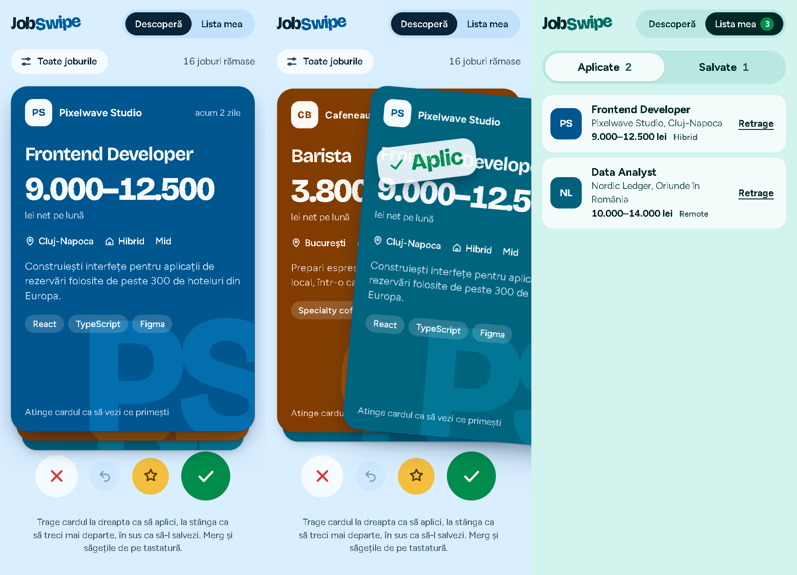

# JobSwipe

Alegi joburi cum ai alege pe Tinder. Tragi cardul la dreapta ca să aplici, la stânga ca să treci mai departe și în sus ca să-l păstrezi pentru mai târziu.



## Ce poți face

- **Răsfoiești joburi una câte una.** Fiecare card arată salariul net, orașul, modul de lucru, nivelul, tehnologiile și o descriere scurtă. Atinge cardul ca să vezi ce beneficii primești.
- **Decizi dintr-un gest.** Pe măsură ce tragi, apare ștampila „Aplic”, „Pas” sau „Salvez”. O aruncare rapidă contează și ea, nu trebuie să tragi până la capăt.
- **Te răzgândești.** Butonul de anulare sau tasta Z readuce ultimul card.
- **Filtrezi** după modul de lucru (remote, hibrid, la sediu), oraș și salariul minim.
- **Îți urmărești alegerile în „Lista mea”**: joburile la care ai aplicat și cele salvate. Din cele salvate poți aplica direct.
- **Alegerile rămân salvate** în browser (`localStorage`) și după ce închizi pagina.

Culoarea paginii se schimbă după jobul pe care îl vezi, iar cardul următor urcă din teanc pe măsură ce îl tragi pe cel de deasupra.

## Comenzi

| Acțiune | Gest | Tastatură |
| --- | --- | --- |
| Aplici | Tragi la dreapta | → |
| Treci mai departe | Tragi la stânga | ← |
| Salvezi | Tragi în sus | ↑ |
| Anulezi ultima alegere | Butonul cu săgeată | Z sau Backspace |
| Vezi beneficiile | Atingi cardul | Space sau Enter |

Fiecare gest are și un buton echivalent sub card. Dacă sistemul tău cere mișcare redusă, aplicația renunță la animații.

## Pornire

Ai nevoie de [Node.js](https://nodejs.org/) 18 sau mai nou.

```bash
npm install
npm run dev
```

Deschide adresa afișată în terminal (de obicei http://localhost:5173).

Pentru versiunea de producție:

```bash
npm run build     # verifică tipurile și generează dist/
npm run preview   # servește dist/ local
```

## Structura

```
src/
  App.tsx                 starea aplicației: alegeri, istoric, filtre, notificări
  components/
    SwipeCard.tsx         cardul: gesturile de tragere, ștampilele, animația de ieșire
    Deck.tsx              teancul de carduri, butoanele, tastatura, ecranele goale
    MyList.tsx            joburile aplicate și cele salvate
    FiltersPanel.tsx      filtrele
    Icons.tsx             iconițe SVG
  data/jobs.ts            lista de joburi
  styles.css              stilurile și culorile
```

Făcut cu React 18, TypeScript și Vite, fără alte biblioteci.

## Datele

Joburile din `src/data/jobs.ts` sunt exemple, iar companiile sunt inventate. Ca să adaugi un job, adaugi un obiect în listă. Câmpul `hue` (0–360) stabilește culoarea cardului.
